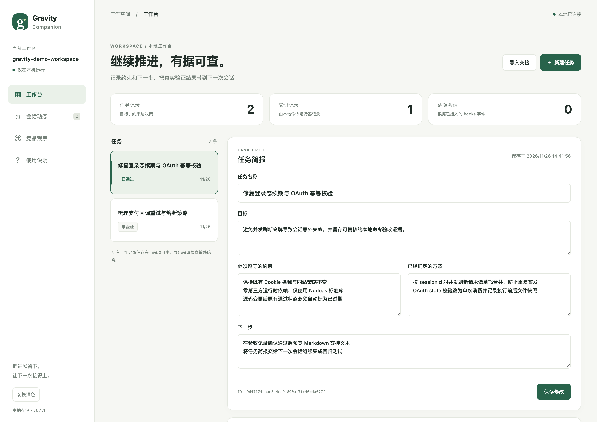
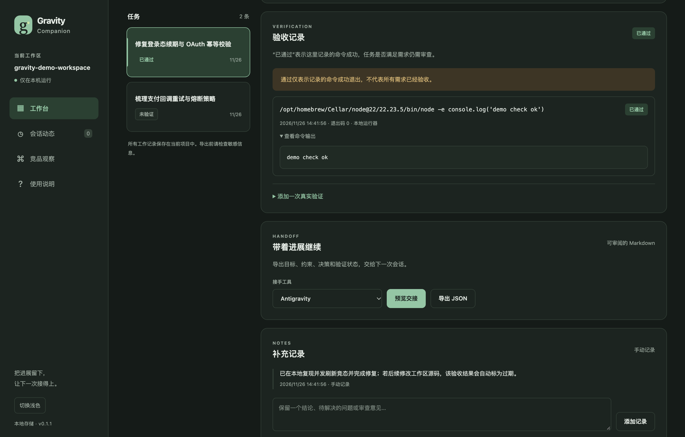

# Gravity Companion

[](LICENSE)
[](package.json)
[](package.json)
[](https://github.com/cool-boy2024/antigravity-companion/actions/workflows/ci.yml)
[](https://github.com/cool-boy2024/antigravity-companion/releases)

用官方 hooks 给 Google Antigravity 补充本地任务面板：记住目标与约束，整理交接记录，检查测试结果是否仍对应当前代码。

这是独立社区项目，MIT 开源。运行需要 Node.js 22+，没有第三方运行时依赖。界面、记录和验证执行器都在本机；项目不读取 Google 登录凭据，也不轮询私有额度接口。

## 界面预览


*浅色模式 · 本地工作台：管理任务目标、硬性约束、已定方案与下一步，仅监听 `127.0.0.1`。*


*深色模式 · 验收证据与跨工具交接：保留真实退出码、命令输出与文件快照，一键预览交接 Markdown / JSON。*

## 🤖 懒人首选：直接发给你的 AI，一句指令自动装好

把下面这段话直接复制发给 **Antigravity / Claude Code / Codex** 等 AI 助手，即可自动完成环境检查、本地测试校验、官方原生插件安装与演示启动：

```text
请帮我自动克隆并安装 https://github.com/cool-boy2024/antigravity-companion ：
先阅读仓库的 AI_INSTALL.md、CLAUDE.md 和 docs/AGENTS.md，检查我的 Node 22+ 和 agy CLI 环境，
完成官方原生插件校验与安装，并先帮我运行演示或初始化当前工作区，完成后告诉我如何打开工作台和启用 hooks。
```

> 全程遵循 [AI_INSTALL.md](AI_INSTALL.md) 安全流程：零第三方运行时依赖、不修改宿主安装包、不读取账号凭据，也不会擅自强开 hooks；安装完成后由你在宿主设置中按需开启。

## 现在能用什么

- 中文任务卡片：编辑目标、约束、已定方案、下一步和手动备注。
- 验收记录：显式运行程序，保存退出状态、时间、最多 64KB 的输出及执行前后文件快照。
- 结果过期检查：代码变了、执行中改了文件，或无法覆盖完整快照时，保留“过期”或“未验证”。相同参数的最新一次执行取代旧结果，历史仍可查看。“已通过”仅表示记录的命令通过，不代表所有需求已验收。
- 跨工具交接：导出给 Antigravity、Codex、Claude Code 使用的 Markdown 或 JSON。接收方重新验证，导入的外部检查不会变成本机通过证据。
- 会话动态：从官方 hooks 接收工具名称、错误有无等元数据，显示后台活动和重复错误提示。安静一段时间只提示确认状态，不判断“卡死”。
- 竞品观察：保留三家已有能力、官方来源、核实日期和开发取舍，避免重复造轮子。

首版不会自动读取对话正文，不会把宿主的工具事件当作测试通过证据。任务卡片需要用户填写，交接目标只改变记录格式与标题，不会自动接管另一家的会话。

## 先在本地运行

### 1 条命令体验 Demo

从 [Releases](https://github.com/cool-boy2024/antigravity-companion/releases) 下载并解压，或克隆仓库。进入本项目根目录后运行：

```sh
npm run demo
```

这会执行 `node src/cli.js demo --open`：在系统临时目录创建独立演示工作区，预置 2 条中文示例任务并真实执行 1 次本地检查命令，随后在 `127.0.0.1` 启动工作台并打开浏览器。按 Ctrl+C 停止后自动清理临时目录，不改动当前仓库或宿主设置（若不想自动打开浏览器，可运行 `node src/cli.js demo`）。

### 在自己的项目中使用

确认 Node.js 版本为 22+ 后，对目标工作区运行：

```sh
node --version
node src/cli.js init --workspace /你的项目目录
node src/cli.js serve --workspace /你的项目目录 --open
```

Windows 路径示例：`--workspace "C:\Users\you\Projects\demo"`。路径有空格时加引号。`--open` 会打开系统浏览器，也可以复制终端显示的链接。服务只监听 `127.0.0.1`，每次启动生成临时访问令牌；不要分享这个链接。按 Ctrl+C 停止。

面板里新建任务，填好约束和下一步。验证命令需要从终端显式运行：

```sh
node src/cli.js task --workspace /你的项目目录 --title "修复登录"
# 把返回的任务 ID 放到下面的 <任务ID> 位置
node src/cli.js check --workspace /你的项目目录 <任务ID> -- node --test
node src/cli.js handoff --workspace /你的项目目录 <任务ID> --target claude
```

`check` 直接启动 `--` 后的程序，不隐式调用 shell。`&&`、管道和重定向不会被解释。你指定的程序仍具有当前用户权限，请只执行自己审查过的命令。Windows 的 `.cmd` 包装器可改为 `node` 加实际 JS 入口。默认 120 秒超时，可在 `--` 前设置 `--timeout 300`。

快照最多覆盖 5,000 个文件、总计 64MiB、单文件 8MiB。Git 项目按被跟踪和未忽略文件计算，排除 `.git`、`node_modules` 和本项目数据目录；非 Git 项目使用有界目录扫描。符号链接不跟随。被忽略的文件、链接目标、外部服务和运行环境变化不在这份新鲜度证明内。

## 接入 Antigravity

独立面板不依赖宿主安装。需要自动会话动态时，再安装原生插件：

```sh
agy plugin validate --strict .
agy plugin install .
agy plugin list --json
```

`agy` 需要是支持原生插件的官方 Antigravity CLI。确认安装目录保留了 `src/`、`web/`、`data/`、`assets/` 和 `plugin.json`，再在宿主 Customizations / Hooks 中启用 `gravity-companion`。本仓库默认禁用 hooks；`init` 为指定工作区创建本地采集授权标记。两处都启用后才会记录，不会采集其他工作区。

hooks 进程的 PATH 需要能找到 `node`。启用后新建一个测试会话，检查动态页是否有新记录。没有事件时先用 `node src/cli.js doctor --workspace /你的项目目录` 检查本地状态，再检查宿主加载情况。兼容性和接入细节见 [接入说明](docs/INTEGRATION.md)。

## 数据与退出

数据在工作区 `.antigravity-companion/` 中，本工具为它写入忽略规则。默认不保存提示词、工具参数、原始错误正文，也不打开 `transcriptPath`。你主动填写的卡片和显式运行的命令输出会保存在本地。

导出会过滤常见密钥格式与用户目录，并省略验证输出；过滤不能识别所有商业信息和隐私。公开分享前检查预览。导入文件填充任务卡片，外部备注和检查只作为标明来源的说明保存，不执行其中的命令或指令，也不会获得本机证据资格。

停用时先关闭宿主中的命名 hook，再关闭本地服务。不再需要记录时，可以删除自己工作区的 `.antigravity-companion/`。卸载插件按当前 `agy plugin --help` 操作；不需要还原应用安装包。

## 持续完善

[能力对照表](docs/COMPETITORS.md) 记录 Codex、Claude Code 和 Antigravity 的已有能力。后续设计优先解决可复现的问题，并记录采用或放弃方案的原因。用户反馈请用仓库的功能请求模板，说明实际场景、期望行为和所用客户端版本，避免上传密钥与完整私有对话。

首版的后续工作是验证不同宿主版本的端到端接入、改善多工作区查看，以及增加可审查的工具适配器。上下文与额度目前继续使用官方入口，本面板不展示猜测数据。

项目使用公开扩展机制，减少修改客户端和依赖私有接口的兼容风险。账号权限、配额与使用政策仍由提供方决定，任何社区插件都无法承诺永不封号。项目不进行账号轮换、不绕过付费额度和风控、不修改宿主权限判断。

## 配套项目

- **Gravity Companion（本仓库）**：零改包原生官方插件，专注任务交接与本地验收证据。
- **[Antigravity Studio Kit](https://github.com/cool-boy2024/antigravity-studio-kit)**：桌面端界面增强套件，提供就地划词追问、全量中文汉化、四套 120Hz 主题与 512K 配额看板，与本插件定位互补、互不依赖。

## 开发和验证

```sh
npm test
npm run check
agy plugin validate --strict .
npm run package
```

`npm run package` 生成可安装的 ZIP 和 SHA-256 校验文件。测试使用 Node 内置测试器，不需要先安装依赖。公开 CI 会检查代码、测试和插件格式；发布前仍需在实际使用的 Antigravity 版本中确认 hook 已触发。已验证范围见 [发布验证记录](docs/VALIDATION.md)。

本项目独立实现，问题选择参考了 [antigravity-community-kit](https://github.com/yuhaojie217/antigravity-community-kit)，未复制其代码或角色素材。Google Antigravity、Codex、Claude 为各自提供方的产品名称，本项目与其没有官方隶属关系。
